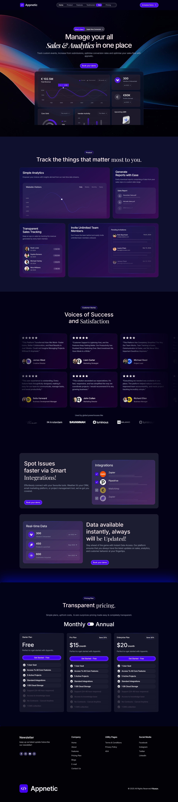

# Appnetic – SaaS Sales & Analytics Landing Page

Appnetic is a modern, dark-themed landing page for a SaaS sales and analytics platform. It presents the product, key features, customer testimonials, integrations and pricing plans in a polished interface designed to convert visitors into demo bookings and sign-ups.



---

## Table of Contents

1. [Overview](#overview)
2. [Features](#features)
3. [Page Structure](#page-structure)
4. [Technologies Used](#technologies-used)
5. [Skills Demonstrated](#skills-demonstrated)
6. [Design System](#design-system)
7. [Repository Structure](#repository-structure)
8. [Installation](#installation)
9. [Customization](#customization)
10. [Key Learnings](#key-learnings)
11. [Author](#author)
12. [License](#license)

---

## Overview

This project is a product landing page for a fictional analytics platform that helps teams manage sales data, generate reports and monitor performance from a single dashboard. It was built to practice designing a complete SaaS marketing website, including dark UI styling, dashboard mockups, pricing tables and conversion-focused layouts.

**Project objectives**

- Present a software product clearly and professionally
- Build a visually distinctive dark interface with gradient and glass-style elements
- Communicate features, social proof and pricing in a logical order
- Guide visitors toward booking a demo or signing up

---

## Features

- Sticky navigation bar with a "Schedule Demo" call-to-action button
- Announcement badge highlighting a new integration
- Hero section with a bold headline and a dashboard preview
- Feature cards covering analytics, reporting, sales tracking and team invitations
- Testimonial grid with star ratings, client names and roles
- Client logo strip under "Used by global powerhouses like"
- Integrations section with selectable integration list
- Real-time data section with key metric cards
- Pricing section with a Monthly and Annual toggle
- Three pricing tiers with feature checklists
- Footer with newsletter signup, link columns and social icons

---

## Page Structure

| Section | Description |
|---|---|
| Header | Logo, navigation (Home, Product, Features, Testimonial, Pricing) and a "Schedule Demo" button |
| Hero | Headline "Manage your all Sales & Analytics in one place", supporting text, "Book your demo" button and a dashboard preview showing revenue, vendors onboarded, profits earned, sales and activity charts |
| Product | "Track the things that matter most to you" with four cards: Simple Analytics, Generate Reports with Ease, Transparent Sales Tracking and Invite Unlimited Team Members |
| Testimonials | "Voices of Success and Satisfaction" with six review cards and a row of client brand logos |
| Integrations | "Spot Issues faster via Smart Integrations" with an integration panel (Zapier, Pipedrive, Mailchimp) |
| Real-Time Data | "Data available instantly, always will be Updated" with metric cards for vendors onboarded, products launched and customers acquired |
| Pricing | "Transparent pricing" with a Monthly / Annual toggle and three plans |
| Footer | Newsletter, Company links, Utility Pages, Social Media links, brand logo and copyright notice |

### Pricing Plans

| Plan | Price | Highlights |
|---|---|---|
| Starter | Free | 1 user seat, core features, 5 active projects, standard integrations, 1 GB cloud storage |
| Pro | $15 / month | Same core features with extended support and knowledge base access |
| Enterprise | $20 / month | Same core features with extended support, knowledge base access and CMS collection |

---

## Technologies Used

| Technology | Purpose |
|---|---|
| WordPress | Content management system |
| Elementor | Visual page builder for layout and design |
| HTML5 and CSS3 | Structure and custom styling |
| Git and GitHub | Version control and project documentation |

Update this table to match the tools you actually used for this project.

---

## Skills Demonstrated

| Skill | How It Was Applied |
|---|---|
| UI/UX Design | Clear visual hierarchy, card layouts and conversion-focused section order |
| Dark Theme Design | Navy and violet palette with gradients and subtle glow effects |
| Typography | Pairing a clean sans-serif with italic serif accent words in headings |
| Component Design | Reusable cards, buttons, badges, toggles and pricing tables |
| Page Building | Constructing a long-form landing page from modular sections |
| Responsive Design | Grid-based layouts that adapt across screen sizes |
| Content Structuring | Ordering sections from product value to proof to pricing to action |
| Interactive Elements | Monthly / Annual pricing toggle, integration selection and hover states |
| Version Control | Managing project files and documentation with Git and GitHub |

---

## Design System

### Color Palette

| Role | Color (approximate) |
|---|---|
| Page background | Deep navy `#0B0E2A` |
| Card surfaces | Dark indigo-purple `#1A1240` |
| Primary accent | Electric violet `#5B2DF5` |
| Text | White `#FFFFFF` |
| Secondary text | Muted gray-lavender `#A9A7C7` |

### Typography

- **Primary font:** Clean geometric sans-serif for headings, body text and navigation
- **Accent font:** Italic serif used to emphasize key words within headlines
- **Hierarchy:** Large, light-weight headings with small, muted supporting text

### Interface Elements

- Rounded, glass-style cards with soft borders
- Gradient hero background with a dashboard mockup
- Pill-shaped violet buttons and badges
- Toggle switch for pricing periods
- Checklist icons for plan features

---

## Repository Structure

```
appnetic/
├── screenshots/
│   └── appnetic-home.png
└── README.md
```

Update this structure to reflect the actual contents of the repository.

---

## Installation

### Prerequisites

- PHP 7.4 or higher
- MySQL 5.7 or higher (or MariaDB equivalent)
- A local server environment such as LocalWP, XAMPP, WAMP or MAMP

### Steps

1. Clone the repository:
   ```bash
   git clone https://github.com/Aqsa-javed8822/appnetic.git
   ```
2. Place the project in your server's web root (`htdocs` or `www`).
3. Create a new database and import the SQL file, if one is provided.
4. Update `wp-config.php` with your database name, username and password.
5. Open the site in your browser and log in at `/wp-admin`.
6. Install and activate the required plugins, including Elementor.

If the project is a static HTML and CSS build, open `index.html` directly in your browser instead.

---

## Customization

- **Brand:** Update the logo, colors and fonts from the theme or page builder settings
- **Content:** Edit headlines, feature cards, testimonials and pricing copy
- **Pricing:** Adjust plan names, prices and feature lists to suit your product
- **Integrations:** Replace the listed integrations and client logos with your own

---

## Key Learnings

- Structuring a SaaS landing page for clarity and conversion
- Designing a consistent dark interface with gradients and glass-style cards
- Building reusable components such as pricing cards and testimonial blocks
- Balancing strong visuals with readable text and clear calls to action
- Documenting a project professionally on GitHub

---

## Author

**Aqsa Javed**

- GitHub: [@Aqsa-javed8822](https://github.com/Aqsa-javed8822)

---


This project is licensed un
